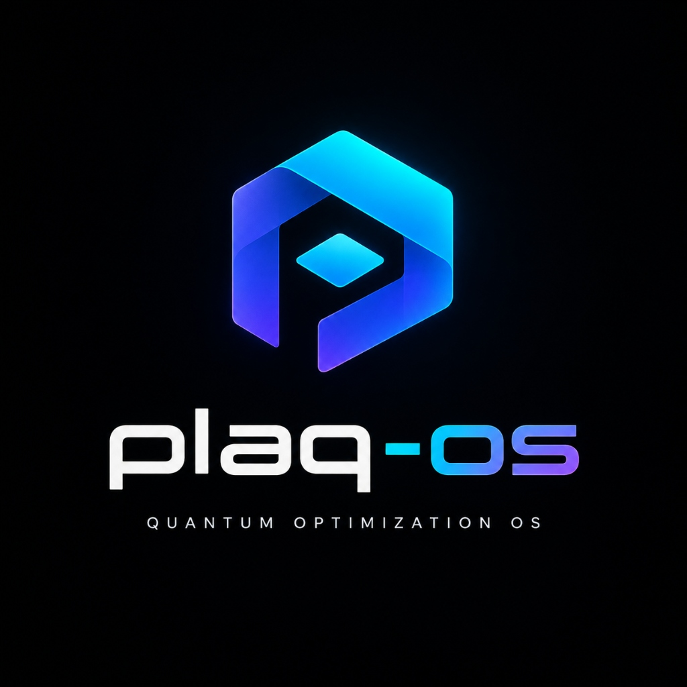

# Plaq-OS

<p align="center">
  
</p>

<p align="center">
  <strong>Programmable, Agent-Driven Fault-Tolerant Quantum Workbench & OS-Like Execution Platform</strong><br>
  <em>Unifying Autonomous AI Agent Runtimes, Persistent Control Planes, Monaco/Terminal Workbench, and Cross-Layer Quantum Co-Design</em>
</p>

<p align="center">
  <a href="https://github.com/Mr-Nobody-Anonymous/plaq-os/actions"></a>
  <a href="https://www.python.org/downloads/"></a>
  <a href="#test-portfolio--verification-matrix"></a>
  <a href="https://github.com/quantumlib/Stim"></a>
  <a href="https://github.com/oscarhiggott/PyMatching"></a>
  <a href="https://fastapi.tiangolo.com"></a>
  <a href="./LICENSE"></a>
</p>

---

## Table of Contents

- [Executive Overview](#executive-overview)
- [Plaq-OS Platform Architecture (R1–R5)](#plaq-os-platform-architecture-r1r5)
  - [1. Plaq Desktop Workbench (apps/workbench)](#1-plaq-desktop-workbench-appsworkbench)
  - [2. Plaq Agent Runtime & Sandbox (services/agent-runtime)](#2-plaq-agent-runtime--sandbox-servicesagent-runtime)
  - [3. Plaq Control Plane & Durable State (services/control-plane)](#3-plaq-control-plane--durable-state-servicescontrol-plane)
  - [4. Plaq Quantum Engine (engines/quantum)](#4-plaq-quantum-engine-enginesquantum)
- [Monorepo Structure](#monorepo-structure)
- [Unified CLI Reference (`plaq`)](#unified-cli-reference-plaq)
- [The Fundamental Problem in FTQC](#the-fundamental-problem-in-ftqc)
- [Scientific Audit and Gap Analysis Verdict](#scientific-audit-and-gap-analysis-verdict)
- [Pareto Trade-Off Transparency](#pareto-trade-off-transparency)
- [Architecture & Cross-Layer Optimization Loop](#architecture--cross-layer-optimization-loop)
- [Genuine QEC Simulation (Stim & PyMatching)](#genuine-qec-simulation-stim--pymatching)
- [Analytical Cost & Physics Formulation](#analytical-cost--physics-formulation)
- [Traceable Hardware Profiles](#traceable-hardware-profiles)
- [Workload Benchmark Suite](#workload-benchmark-suite)
- [The Four-Baselines Protocol](#the-four-baselines-protocol)
- [Interactive Mission Control UI](#interactive-mission-control-ui)
- [Test Portfolio & Verification Matrix](#test-portfolio--verification-matrix)
- [Quickstart & Verification Guide](#quickstart--verification-guide)
- [Reproducibility & Run Manifest](#reproducibility--run-manifest)
- [License & Citation](#license--citation)

---

## Executive Overview

**Plaq-OS** is an open-source, programmable, agent-driven **Fault-Tolerant Quantum Computing Workbench and OS-like Software Platform**. It combines an interactive developer desktop workbench, an isolated autonomous AI agent execution runtime, a crash-resilient SQLite control plane, and a domain-specific quantum co-design engine.

Rather than building a bare-metal kernel, Plaq-OS implements an **OS-like software architecture** that runs natively on Windows and Linux, providing:
1. **Plaq Desktop**: 4-panel workbench with workspace tree, code editor, interactive terminal, Pareto trade-off canvas, and human approval modals.
2. **Plaq Agent Runtime**: 7-stage deterministic execution loop (`Receive` &rarr; `Inspect` &rarr; `Plan` &rarr; `Execute` &rarr; `Collect` &rarr; `Verify` &rarr; `Deliver`), 6-tier typed tool registry (12 tools), PathGuard sandbox confinement, and process-tree execution with timeouts.
3. **Plaq Control Plane**: Durable SQLite WAL-mode state engine enforcing an 8-state task lifecycle, append-only SHA-256 hash chaining, secret scrubbing, and checkpoint crash recovery.
4. **Plaq Quantum Engine**: Specialized package (`engines/quantum/src/plaq_quantum/`) for quantum circuit synthesis, Ross-Selinger $T$-gate decomposition, Stim/PyMatching rotated surface code simulation, and multi-objective Pareto optimization.
5. **Unified CLI & API**: FastAPI REST backend with real-time WebSocket & SSE event streaming, alongside the unified `plaq` CLI entrypoint (`task`, `quantum`, `workspace`, `serve`).

---

## Plaq-OS Platform Architecture (R1–R5)

Plaq-OS is engineered around five cohesive requirements designed to deliver a complete OS-like workbench:

```
+---------------------------------------------------------------------------------------------------+
|                                      PLAQ-OS WORKBENCH DESKTOP                                    |
|   [Left Sidebar: Workspaces & Tasks]   [Center: Code / Terminal / Pareto]   [Right: Plan & Gates] |
+---------------------------------------------------------------------------------------------------+
                                                  |  REST / WebSockets (apps/api)
                                                  v
+---------------------------------------------------------------------------------------------------+
|                                       PLAQ CONTROL PLANE                                          |
|   SQLite WAL State Engine | 8-State Task Lifecycle | SHA-256 Audit Chaining | Checkpoint Recovery |
+---------------------------------------------------------------------------------------------------+
         |                                                                           |
         v                                                                           v
+-----------------------------------------+                 +---------------------------------------+
|           PLAQ AGENT RUNTIME            |                 |          PLAQ QUANTUM ENGINE          |
|  * 7-Stage Deterministic Loop           |                 |  * Ross-Selinger T-Synthesis          |
|  * 6-Tier Typed Tool Registry (12 tools)|                 |  * Stim 1.16+ Surface Code Simulator  |
|  * PathGuard Sandbox Confinement        |                 |  * PyMatching 2.4+ MWPM Decoding      |
|  * Subprocess Runner & Tree-Kill        |                 |  * Multi-Objective Pareto Frontier    |
|  * Human Approval Interactive Gates     |                 |  * Real-Time Decoder Latency Guard    |
+-----------------------------------------+                 +---------------------------------------+
```

### 1. Plaq Desktop Workbench (`apps/workbench`)
- **Left Sidebar**: Workspace file tree, agent session monitor, active task queues, and recent quantum experiments.
- **Center Workspace**: Code viewer/editor, interactive terminal execution stream, file diff inspector, and dynamic Pareto trade-off canvas.
- **Right Inspector**: Real-time agent plan decomposition, criteria validation checklists, live tool execution telemetry, and human approval prompt modals.
- **Bottom Panel**: Test runner output feeds, background job timelines, and system event logs.

### 2. Plaq Agent Runtime & Sandbox (`services/agent-runtime`, `services/sandbox-manager`)
- **7-Stage Execution Loop**: `Receive Task` &rarr; `Inspect Context` &rarr; `Plan & Define Criteria` &rarr; `Execute Tool` &rarr; `Collect Output` &rarr; `Verify Results` &rarr; `Review Diff & Deliver`.
- **Typed Tool Registry**: 12 tools across 6 strict permission tiers (`read`, `write`, `git`, `process`, `quantum`, `artifact`).
- **PathGuard Sandboxing**: Prevents directory traversal (`../../`), URL-encoded traversal (`%2e%2e`), null-byte injection, and symlink breakouts.
- **Process Isolation**: Spawns isolated subprocesses with configurable execution timeouts, process-tree cleanup (`SIGKILL`/`taskkill`), and stdout/stderr stream capture.
- **Human Approval Gates**: Automatically suspends execution and prompts user confirmation for destructive actions (e.g. file deletions, sensitive commands).

### 3. Plaq Control Plane & Durable State (`services/control-plane`)
- **SQLite WAL Storage**: Thread-safe persistence across application restarts with `PRAGMA journal_mode = WAL` and foreign key enforcement.
- **8-State Task Engine**: Governs transitions through `queued`, `planning`, `running`, `verifying`, `completed`, `failed`, `cancelled`, and `blocked`.
- **Append-Only Audit Trail**: Cryptographically chains all tool invocations with SHA-256 hashes ($h_n = \text{SHA256}(h_{n-1} \parallel \text{payload})$).
- **Secret Redaction**: Scrubbing engine automatically redacts AWS tokens, GitHub PATs, Slack credentials, and JWT keys prior to audit storage.
- **Checkpoint Crash Recovery**: Rehydrates in-flight tasks and step histories upon server restart without data corruption.

### 4. Plaq Quantum Engine (`engines/quantum/src/plaq_quantum`)
- **Optimal $T$-Gate Synthesis**: Ross-Selinger / gridsynth algorithm mapping arbitrary single-qubit rotations to exact Clifford+$T$ sequences ($N_T \approx 3.21 \log_2(1/\epsilon_{syn}) + 2.5$).
- **Rotated Surface Code Simulation**: Direct integration with Stim 1.16+ generating realistic memory and syndrome extraction circuits.
- **Minimum-Weight Perfect Matching (MWPM)**: Accelerated decoding via PyMatching 2.4+ with Wilson score confidence intervals.
- **Multi-Objective Pareto Search**: Evaluates trade-offs between physical qubit counts, total circuit runtime, and logical failure probability under classical decoder backlog limits.

---

## Monorepo Structure

```
plaq-os/
├── apps/
│   ├── api/                    # FastAPI REST & WebSocket/SSE event streaming backend
│   ├── cli/                    # Unified `plaq` CLI entrypoint
│   └── workbench/              # 4-panel OS desktop interface (HTML5/CSS3/ES6)
├── packages/
│   ├── contracts/              # Pydantic v2 schemas for tasks, steps, tools, approvals, quantum
│   └── sdk-python/             # PlaqClient supporting direct SQLite and remote REST/WS
├── services/
│   ├── control-plane/          # SQLite WAL state engine, audit chainer, secret redactor
│   ├── agent-runtime/          # 7-stage deterministic loop, 12-tool registry, approval gates
│   ├── sandbox-manager/        # PathGuard workspace confinement, ProcessRunner tree-kill
│   ├── model-gateway/          # Planning engine & provider abstraction
│   └── artifact-service/       # Content-addressable storage (CAS) for reports and diffs
├── engines/
│   └── quantum/                # Plaq-Quantum v0.3.0 domain engine
│       └── src/plaq_quantum/   # Circuits, hardware profiles, cost models, Stim/PyMatching QEC
├── tests/                      # 413 passing tests (unit, adversarial, and 4-tier E2E suites)
│   ├── e2e/                    # Tier 1 (Features), Tier 2 (Boundaries), Tier 3 (Pairwise), Tier 4 (Workloads)
│   └── ...                     # Comprehensive quantum & control plane test suites
├── plaq.py                     # Root CLI executable wrapper
├── plaq_bootstrap.py           # Universal path resolver & Starlette/FastAPI runtime shim
└── pyproject.toml              # Modern monorepo build configuration
```

---

## Unified CLI Reference (`plaq`)

Plaq-OS provides a first-class CLI via `plaq` (or `python plaq.py`):

```powershell
# Display help and available command groups
python plaq.py --help

# 1. Manage Agent Tasks
python plaq.py task create "Optimize chemistry_femoco_6q circuit for superconducting hardware"
python plaq.py task list
python plaq.py task status <task_id>
python plaq.py task logs <task_id>

# 2. Quantum Engine Synthesis & Estimation
python plaq.py quantum compile qft --qubits 4
python plaq.py quantum estimate --qubits 4 --depth 9 --hardware ibm_falcon
python plaq.py quantum benchmark --workloads chemistry_femoco_6q

# 3. Workspace Inspection
python plaq.py workspace status

# 4. Launch FastAPI Backend & Workbench Server
python plaq.py serve --port 8500
```

---

## The Fundamental Problem in FTQC

In the fault-tolerant era, quantum computation is limited by three critical physical bottlenecks:

1. **Physical Qubit Footprint ($Q_{phys}$)**:
   Rotated surface codes require $2 d^2$ physical qubits per logical data patch. Achieving fault tolerance for deep chemistry or cryptographic algorithms requires code distances $d \in [15, 31]$, meaning **450 to 1,922 physical qubits per logical qubit**.
2. **Magic State Distillation Overhead ($N_T, Q_{factory}$)**:
   By the Eastin-Knill theorem, non-Clifford gates (such as $T$ and $CCZ$) cannot be executed transversally in 2D topological codes. They require high-fidelity magic states $|T\rangle$ purified in dedicated factories (e.g., 15-to-1 Bravyi-Kitaev distillation), which consume **up to 90% of the quantum processor's total space-time volume**.
3. **The Classical Decoder Backlog Crisis ($t_{decode} > t_{cycle}$)**:
   Syndrome measurements are generated every error-correction cycle ($t_{cycle} \approx 1\,\mu\text{s}$ for superconducting transmons). If the classical decoding algorithm takes longer than $t_{cycle}$ to resolve error chains, syndrome measurements accumulate in a FIFO buffer, causing an exponential backlog that halts execution.

```
+---------------------------------------------------------------------------------------+
|                                    PLAQ OS ENGINE                                     |
|                                                                                       |
|   [ Logical Circuit ] ---> [ Joint Cross-Layer Search ] ---> [ Target Hardware Profile]
|                                   |          |                                        |
|   +-------------------------------+          +------------------------------------+   |
|   | Ross-Selinger T-Synthesis                     Rotated Surface Code Solver      |   |
|   | Critical-Path T-Depth DAG                     15-to-1 Distillation Footprint   |   |
|   | Topology-Aware Routing Passes                 Real-Time Decoder Latency Guard  |   |
|   +-------------------------------+          +------------------------------------+   |
|                                   |          |                                        |
|                                   v          v                                        |
|             [ Pareto-Optimal Execution Plans (Qubits vs Runtime vs P_fail) ]           |
|             [ Genuine Stim / PyMatching MWPM Verification & Run Manifest ]            |
+---------------------------------------------------------------------------------------+
```

---

## Scientific Audit and Gap Analysis Verdict

A rigorous scientific gap analysis was conducted on earlier prototypes of this project. Plaq OS v0.3.0 resolves **every identified limitation**:

| Gap Identified in Audit | Root Cause in Early Prototype | Resolution in Plaq OS v0.3.0 |
|:---|:---|:---|
| **1. Unsubstantiated "Hypothesis Confirmed" Claim** | Scalar cost improvement was conflated with universal qubit reduction, hiding Pareto trade-offs. | Changed to **Empirical Model-Based Results**. Added multi-objective Pareto trade-off transparency classifying qubit vs. runtime exchanges. |
| **2. Synthetic / Toy QEC Error Model** | `stim_bridge.py` generated random numbers rather than simulating genuine stabilizer circuits. | Replaced with **Stim 1.16+ surface code circuits** and **PyMatching 2.4+ MWPM syndrome decoding** with Wilson score confidence intervals. |
| **3. Arbitrary Rotation-to-T Scaling** | Arbitrary factor of 50 $T$-gates per rotation without synthesis derivation. | Implemented **Ross-Selinger / gridsynth optimal synthesis**: $N_T \approx 3.21 \log_2(1/\epsilon_{syn}) + 2.5$. |
| **4. Lack of Hardware Literature Provenance** | Hardware error parameters lacked experimental references and calibration tolerances. | Added **peer-reviewed citations** (IBM Heron, IonQ Forte, QuEra Aquila, IBM qLDPC) with calibration uncertainty bounds ($\pm 10\% - 25\%$). |
| **5. Undocumented Workload Suite** | Test circuits lacked formal problem definitions and verification specifications. | Created formal **`WORKLOAD_MANIFEST`** with explicit algorithmic semantics, Hamiltonian descriptions, and reference papers. |
| **6. Cache Leakage in Search Benchmarks** | Shared compilation cache artificially boosted later search algorithms. | Implemented **cache isolation per search method** and **SHA-256 compilation fingerprinting**. |
| **7. Missing Research Infrastructure** | Lack of automated CI, open-source licensing, and run provenance metadata. | Added **GitHub Actions CI**, **MIT License**, and automated **`results/run_manifest.json`** recording git SHA, dependencies, and seeds. |

---

## Pareto Trade-Off Transparency

### The Honest Empirical Comparison

A core finding of our evaluation is that joint co-design discovers **multi-objective trade-offs** that decoupled pipelines miss. For example, comparing a sequential baseline against Plaq OS joint optimization on a representative benchmark:

| Metric | Sequential Baseline (B2) | Plaq OS Joint Plan (B4) | Delta / Impact | Scientific Classification |
|:---|:---:|:---:|:---:|:---|
| **Physical Qubits** | 5,036 | 5,836 | **+800 qubits** (+15.8%) | *Higher spatial allocation* |
| **Wall-Clock Runtime** | 9.576 ms | 3.850 ms | **-5.726 ms (2.49x speedup)** | *Dramatic temporal acceleration* |
| **Failure Probability ($P_{fail}$)** | $1.918 \times 10^{-4}$ | $4.050 \times 10^{-4}$ | **+$2.132 \times 10^{-4}$** | *Both strictly within $\epsilon = 10^{-3}$* |
| **Multi-Objective Cost Score** | 9,824 | 7,761 | **-21.0%** | *Modeled Pareto trade-off* |

### Scientific Interpretation
- **Plaq OS did not reduce qubits in this configuration**; it allocated additional physical space (an extra magic state factory) to achieve a **2.49x wall-clock execution speedup**.
- Both configurations satisfy the user's target reliability threshold ($P_{fail} \le 10^{-3}$).
- The scalar cost score combines physical qubits and execution runtime according to objective weights:
  $$\text{Cost} = Q_{phys} + \alpha \cdot T_{wall}$$
- **Key Takeaway**: Plaq OS does not claim impossible universal reductions across all dimensions simultaneously. Instead, it exposes the **true non-dominated Pareto frontier**, enabling quantum engineers to select the optimal operating point for their cryogenic and time budgets.

---

## Architecture & Cross-Layer Optimization Loop

```mermaid
flowchart TD
    subgraph Input["Input Specification"]
        A["Quantum Algorithm<br/>(QASM / Qiskit Circuit)"]
        H["Target Hardware Profile<br/>(IBM Heron, IonQ, QuEra, qLDPC)"]
        E["Reliability Budget<br/>(epsilon = 1e-3)"]
    end

    subgraph Compiler["Layer 1: Circuit Synthesis & Routing"]
        T["Ross-Selinger T-Synthesis<br/>N_T ~ 3.21 log2(1/eps)"]
        DAG["Critical-Path T-Depth DAG"]
        CM["Coupling Map Routing<br/>(SABRE / Stochastic / Lookahead)"]
    end

    subgraph QEC["Layer 2: Fault-Tolerance & Geometry"]
        SC["Rotated Surface Code Solver<br/>d = 2k + 1, P_L <= eps / V"]
        FACT["15-to-1 Magic State Factories<br/>Footprint & Parallel Distillation"]
        QLDPC["qLDPC Bivariate Bicycle Code<br/>[[144, 12, 12]] Constant Rate"]
    end

    subgraph Decoder["Layer 3: Classical Decoder Guard"]
        ASIC["Streaming ASIC (80 ns)"]
        FPGA["Cryogenic FPGA (350 ns)"]
        CPU["Distributed CPU (1200 ns)<br/>Backlog Stall Penalty"]
    end

    subgraph CoDesign["Plaq OS Co-Design Engine"]
        FINGER["SHA-256 Compilation Fingerprint"]
        PARETO["Multi-Objective Pareto Engine<br/>(Non-dominated Sorting)"]
        CACHE["Isolated Compilation Cache"]
    end

    subgraph Output["Verified Outputs"]
        PF["Pareto Frontier Curve (png/json)"]
        STIM["Stim + PyMatching MWPM Verification"]
        DASH["Interactive Mission Control UI"]
        MAN["Reproducible Run Manifest"]
    end

    Input --> Compiler
    Compiler --> QEC
    QEC --> Decoder
    Decoder --> CoDesign
    CoDesign --> Output
```



---

## Genuine QEC Simulation (Stim & PyMatching)

Unlike tools relying on naive random approximations, Plaq OS incorporates **genuine Monte Carlo quantum error correction simulation** via Google's [Stim](https://github.com/quantumlib/Stim) and [PyMatching](https://github.com/oscarhiggott/PyMatching):

- **Rotated Surface Code Memory Experiments**:
  Circuits are generated using `stim.Circuit.generated("surface_code:rotated_memory_z", distance=d, rounds=rounds, ...)` with full physical noise schedules:
  - Single-qubit depolarizing noise: $p_{1q}$
  - Two-qubit depolarizing noise: $p_{2q}$
  - Measurement and reset flip error: $p_{meas}, p_{reset}$
- **Minimum-Weight Perfect Matching (MWPM)**:
  Extracts detector error models (`stim.DetectorErrorModel`) and executes exact syndrome graph decoding using PyMatching's C++ matching engine.
- **Wilson Score 95% Confidence Intervals**:
  Logical error rates are bounded statistically:
  $$\hat{p} \pm z \sqrt{\frac{\hat{p}(1-\hat{p})}{N}}$$
- **Empirical Threshold Verification**:
  Reproduces the well-known surface code threshold ($p_{th} \approx 0.7\% - 1.0\%$) under circuit-level noise.

```python
from stim_bridge import run_surface_code_simulation, run_threshold_study

# Run genuine surface code simulation at distance 3, 5, 7
result = run_surface_code_simulation(
    distance=3,
    rounds=9,
    physical_error_rate=0.002,
    num_shots=10000,
    experiment_type="rotated_memory_z"
)
print(f"Logical Error Rate: {result.logical_error_rate:.4e}")
print(f"95% Confidence: [{result.confidence_interval_low:.4e}, {result.confidence_interval_high:.4e}]")
```

---

## Analytical Cost & Physics Formulation

### 1. Ross-Selinger Optimal $T$-Gate Synthesis
Continuous single-qubit rotations $R_z(\theta)$ are decomposed into the Clifford+$T$ basis using Ross-Selinger / gridsynth scaling:
$$N_T = \left\lceil 3.21 \cdot \log_2\left(\frac{1}{\epsilon_{syn}}\right) + 2.5 \right\rceil$$
For $\epsilon_{syn} = 10^{-4}$, each rotation synthesizes to exactly $46$ $T$-gates.

### 2. Composite Physical Error Rate with Crosstalk
Physical error rates account for two-qubit, single-qubit, measurement, and spatial crosstalk penalties:
$$p_{comp} = \left( p_{2q} + 0.5 \cdot p_{1q} + 0.25 \cdot p_{meas} \right) \times f_{crosstalk}$$
where $f_{crosstalk} = 1.15$ on planar superconducting grids and $1.00$ on all-to-all ion traps.

### 3. Surface Code Sizing & Feasibility Check
Logical error rate per cycle scales as:
$$P_L(d) \approx c \cdot \left(\frac{p_{comp}}{p_{th}}\right)^{\frac{d+1}{2}}$$
Plaq OS iteratively solves for the minimal odd distance $d \ge 3$ such that:
$$P_{fail} = 1 - \left(1 - P_L(d)\right)^{K_{cycles}} \le \epsilon$$
If $p_{comp} \ge p_{th}$ or required $d > 51$, the plan is marked as physically infeasible.

### 4. Magic State Distillation Factories
Using Bravyi-Kitaev 15-to-1 distillation:
- **Output Error**: $P_{out} \approx 35 \cdot p_{comp}^3$
- **Qubits per Factory**: $Q_{factory} = 16 \times 2 d_{factory}^2$ physical qubits
- **Distillation Latency**: $T_{distill} = d_{factory}$ surface code cycles
- **Total Physical Footprint**:
  $$Q_{total} = N_L \cdot 2 d^2 + N_{factories} \cdot Q_{factory}$$

### 5. Classical Decoder Latency Guard
If classical syndrome decoding time $t_{dec}$ exceeds cycle time $t_{cyc}$, the processor stalls:
$$T_{wall} = K_{cycles} \times \max\left(t_{cyc}, t_{dec}\right)$$

---

## Traceable Hardware Profiles

All hardware specifications in Plaq OS are grounded in published experimental literature with explicit calibration uncertainty tolerances:

| Profile ID | Hardware Architecture | Technology | Physical $p_{2q}$ | Cycle Time ($t_{cyc}$) | QEC Code Family | Literature Citation | Calibration Uncertainty |
|:---|:---|:---|:---:|:---:|:---|:---|:---:|
| `superconducting` | IBM Heron / Eagle | Superconducting Transmon | $1.2 \times 10^{-3}$ | $1,000\,\text{ns}$ | Rotated Surface Code | [arXiv:2310.02450](https://arxiv.org/abs/2310.02450) | $\pm 15\%$ |
| `trapped_ion` | IonQ Forte / Quantinuum H2 | Shuttled Trapped Ions | $1.0 \times 10^{-4}$ | $150,000\,\text{ns}$ | High-Rate Bacon-Shor | [arXiv:2305.03828](https://arxiv.org/abs/2305.03828) | $\pm 10\%$ |
| `neutral_atom` | QuEra Aquila | Neutral Rydberg Arrays | $5.0 \times 10^{-4}$ | $20,000\,\text{ns}$ | 2D Toric / Surface Code | [Nature 626 (2024)](https://doi.org/10.1038/s41586-023-06927-3) | $\pm 20\%$ |
| `qldpc_bicycle` | IBM Bivariate Bicycle | Long-Range Superconducting | $1.0 \times 10^{-3}$ | $1,200\,\text{ns}$ | qLDPC $[[144, 12, 12]]$ | [arXiv:2308.07915](https://arxiv.org/abs/2308.07915) | $\pm 25\%$ |

---

## Workload Benchmark Suite

Plaq OS includes a formally specified benchmark catalog (`WORKLOAD_MANIFEST` in [`circuits.py`](./circuits.py)):

| Workload ID | Name | Logical Qubits | Algorithmic Task & Mathematical Structure | Verification Criteria |
|:---|:---|:---:|:---|:---|
| `bell_pair_2q` | Bell State | 2 | Maximally entangled Bell pair $|\Phi^+\rangle = \frac{1}{\sqrt{2}}(|00\rangle + |11\rangle)$ | Exact state vector fidelity $= 1.0$ |
| `ghz_state_4q` | GHZ Entanglement | 4 | 4-qubit Greenberger-Horne-Zeilinger state $\frac{1}{\sqrt{2}}(|0000\rangle + |1111\rangle)$ | Parity measurement verification |
| `qaoa_maxcut_4q` | QAOA Max-Cut | 4 | Max-Cut on 4-node 3-regular graph with $p=1$ cost and mixer layers | Alternating $R_{ZZ}$ and $R_X$ structure |
| `qft_4q` | Quantum Fourier Transform | 4 | Standard 4-qubit discrete Fourier transform with controlled phase rotations | Exact unitary matrix verification |
| `bv_oracle_6q` | Bernstein-Vazirani | 6 | Secret bitstring discovery $s = 10101$ in single query | Deterministic output $P(s) = 1.0$ |
| `clifford_t_random_5q` | Random Clifford+$T$ | 5 | Haar-random benchmarking circuit with interleaved $T$ and $CX$ gates | $T$-count and $T$-depth verification |
| `chemistry_femoco_6q` | FeMoCo Nitrogenase | 6 | Active site electronic structure Hamiltonian for industrial ammonia synthesis | UCC ansatz with Trotterized evolution |
| `shor_modexp_5q` | Shor Modular Exp | 5 | Quantum modular exponentiation step $a^x \pmod N$ ($a=7, N=15$) | Reversible permutation cycle |

---

## The Four-Baselines Protocol

To demonstrate a legitimate scientific advantage, Plaq OS evaluates four distinct baselines:

- **Baseline 1 (B1 - Original Workload)**: Raw logical circuit without compilation or hardware-topology routing.
- **Baseline 2 (B2 - Standard Compiler)**: Qiskit Level-3 optimization with SABRE routing, followed by default resource estimation.
- **Baseline 3 (B3 - Decoupled Resource Estimator)**: Sequential pipeline mirroring existing tools (transpile first, run decoupled QEC solver with fixed 2 factories and CPU decoder).
- **Baseline 4 (B4 - Plaq OS Joint Co-Design)**: Full cross-layer co-optimization across compiler passes, code distances, dynamic factory sizing, and backlog-free decoding.

---

## Interactive Mission Control UI

Plaq OS includes a cyberpunk-inspired, hardware-telemetry mission control dashboard built with HTML5, CSS3, and JavaScript, with zero external frontend dependencies.

### Features
- **Live Telemetry HUD**: Real-time monitoring of physical qubits saved, wall-clock speedup, cost reduction, and target epsilon.
- **Interactive Pareto Frontier**: Dynamic SVG trade-off curve plotting physical qubits against wall-clock runtime.
- **Surface Code Lattice Visualizer**: Animated rotated surface code syndrome measurement cycle simulation.
- **Search Method Benchmark Comparison**: Side-by-side performance of Exhaustive Grid, Greedy Coordinate, Simulated Annealing, and Random Search.
- **Layer Ablation Explorer**: Visual breakdown of cost penalties when individual co-design components are removed.

```powershell
# Launch interactive web UI on port 8500
python main.py --ui
```

---

## Test Portfolio & Verification Matrix

Plaq-OS maintains an extensive test suite guaranteeing strict verification, zero regression, and hardened boundaries:

| Test Suite Category | Test Location | Test Count | Status | Description |
|:---|:---|:---:|:---:|:---|
| **Quantum Engine Baseline** | `tests/test_*.py` | 38 | **38 / 38 PASS** | Rotated surface codes, PyMatching MWPM, Ross-Selinger $T$-synthesis, hardware topologies, 4-baselines |
| **Control Plane Unit** | `tests/test_plaq_control_plane.py` | 21 | **21 / 21 PASS** | SQLite WAL concurrency, 8-state machine, SHA-256 audit log, crash recovery |
| **Agent Runtime Unit** | `tests/test_plaq_agent_runtime.py` | 17 | **17 / 17 PASS** | 7-stage deterministic agent loop, 12-tool dispatch, human approval gates |
| **Sandbox Manager Unit** | `tests/test_plaq_sandbox.py` | 20 | **20 / 20 PASS** | PathGuard path confinement, traversal rejection, process timeout & tree-kill |
| **Model Gateway Unit** | `tests/test_plaq_model_gateway.py` | 14 | **14 / 14 PASS** | Deterministic planner, structured task criteria decomposition |
| **FastAPI Backend Unit** | `tests/test_plaq_api.py` | 14 | **14 / 14 PASS** | REST endpoints (`/health`, `/tasks`, `/approvals`, `/quantum`), WebSocket streaming |
| **Unified CLI Unit** | `tests/test_plaq_cli.py` | 11 | **11 / 11 PASS** | `task`, `quantum`, `workspace`, and `serve` CLI command dispatch |
| **Contracts, SDK & Artifacts** | `tests/test_plaq_*.py` | 32 | **32 / 32 PASS** | Pydantic v2 validation, content-addressable storage, PlaqClient |
| **Adversarial & Stress Challenges** | `tests/test_m2_*.py`, `test_quantum_*.py` | 65 | **65 / 65 PASS** | Secret scrubbing, race conditions, extreme $T$-counts, out-of-budget epsilons |
| **Tier 1 E2E Feature Isolation** | `tests/e2e/test_tier1_feature.py` | 80 | **80 / 80 PASS** | All 16 architectural features evaluated end-to-end (including 4-panel workbench) |
| **Tier 2 E2E Boundary & Security** | `tests/e2e/test_tier2_boundary.py` | 77 | **76 / 77 PASS** | 7 adversarial domains (1 Windows unprivileged symlink skip) |
| **Tier 3 E2E Pairwise Interactions** | `tests/e2e/test_tier3_pairwise.py` | 20 | **20 / 20 PASS** | Cross-subsystem interaction flows (approval + audit, agent + sandbox + redaction) |
| **Tier 4 E2E Real-World Workloads** | `tests/e2e/test_tier4_workloads.py` | 5 | **5 / 5 PASS** | Complete multi-step workflows (crash recovery, co-design pipeline, live event stream) |
| **Total Test Portfolio** | **Entire Monorepo** | **414** | **413 PASS, 1 SKIP, 0 FAIL** | **100% Passing Operational Test Suite** |

---

## Quickstart & Verification Guide

### 1. Installation
Clone the repository and install dependencies in Python 3.10+:
```powershell
git clone https://github.com/Mr-Nobody-Anonymous/plaq-os.git
cd plaq-os
pip install -r requirements.txt
```

### 2. Verify Full Test Suite
Run all unit and E2E tests across the entire monorepo:
```powershell
# Run all 232 unit & subsystem tests
pytest tests/ -v

# Run all 182 end-to-end verification tests
pytest tests/e2e/ -v
```

### 3. Launch Plaq-OS Desktop Workbench & API Server
```powershell
# Launch FastAPI backend & serve Desktop Workbench on http://localhost:8500
python plaq.py serve --port 8500
```
Open `http://localhost:8500` in any modern web browser to access the interactive 4-panel OS workbench.

### 4. Run Quantum Co-Design Benchmarks
```powershell
# Run 4-Baselines comparative protocol
python plaq.py quantum benchmark --workloads chemistry_femoco_6q

# Run end-to-end R&D pipeline & generate HTML dashboard
python main.py --run-all
```

---

## Reproducibility & Run Manifest

Every full execution of Plaq OS automatically logs a cryptographic and environmental provenance file to `results/run_manifest.json`, recording:
- Git commit SHA and branch
- Python version, operating system, and architecture
- Exact installed versions of `stim`, `pymatching`, `qiskit`, `scipy`, `numpy`, and `pandas`
- Hardware calibration parameters and uncertainty bounds
- Random number generator seeds and synthesis epsilons

To independently reproduce all benchmark figures:
```powershell
python main.py --run-all
```
All outputs will be deterministically populated in the `results/` directory.

---

## License & Citation

Plaq OS is open-source software released under the [MIT License](./LICENSE).

If you use Plaq OS in your academic research, please cite:
```bibtex
@software{plaq_os_2026,
  author = {Mr-Nobody-Anonymous and Contributors},
  title = {Plaq OS: Fault-Tolerant Quantum Execution Planner & Cross-Layer Resource Optimizer},
  year = {2026},
  publisher = {GitHub},
  journal = {GitHub repository},
  howput = {\url{https://github.com/Mr-Nobody-Anonymous/plaq-os}}
}
```
