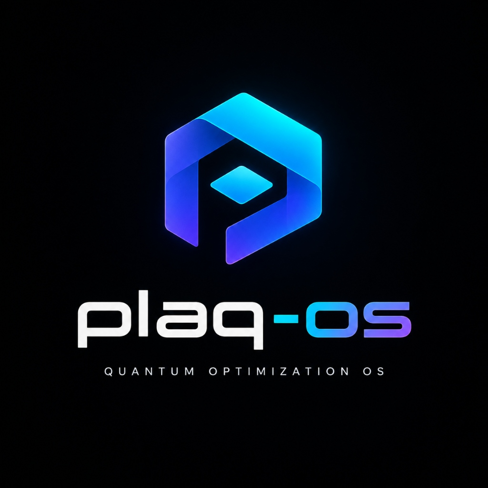

# Plaq-OS

<p align="center">
  
</p>

<p align="center"><strong>A local workbench for exploring quantum circuits, error correction, and resource estimates.</strong></p>

<p align="center">
  <a href="https://github.com/Mr-Nobody-Anonymous/plaq-os/actions/workflows/ci.yml"></a>
  <a href="https://www.python.org/"></a>
  <a href="LICENSE"></a>
</p>

Plaq-OS brings a quantum lab, an agent task runner, and a browser workbench together in one Python project. Try a Bell circuit, estimate fault-tolerant resources, or explore a surface-code simulation—all on your own machine.

> **Before you begin:** Plaq-OS is a research prototype for trusted local use. Its results are simulations and model-based estimates, **not** real quantum-hardware measurements. The process runner is not a security sandbox. Do not expose the service to untrusted users or run untrusted tasks. See [Safety and limitations](#safety-and-limitations).

## What can I do with it?

| Explore | What you get |
| --- | --- |
| **Quantum circuits** | Compile named workloads, inspect circuit metrics, and run local statevector or shot simulations. |
| **Error correction** | Run rotated surface-code experiments with Stim and PyMatching, including confidence intervals. |
| **Resource planning** | Estimate code distance, physical qubits, runtime, and failure probability under a chosen model. |
| **Trade-offs** | Compare candidate designs on a Pareto frontier and run baseline benchmarks. |
| **NISQ lab** | Try simplified noise, mitigation, routing, VQE, repetition codes, and lattice-surgery estimates. |
| **Agent tasks** | Create tasks, review approvals, inspect logs, and store SHA-256-checked artifacts. |
| **Interfaces** | Use the browser workbench, CLI, REST API, Python SDK, or MCP server. |

New to quantum computing? Start with the [Bell-state example](#try-your-first-experiment). Curious about what the lab models and what it does not? Read the [NISQ ↔ FTQC lab guide](docs/NISQ_FTQC_LAB.md).

## Quick start

You need **Python 3.10, 3.11, or 3.12**, Git, and an internet connection to install dependencies.

### Linux, macOS, or WSL

```bash
git clone https://github.com/Mr-Nobody-Anonymous/plaq-os.git
cd plaq-os
./install.sh --dev
source .venv/bin/activate
plaq doctor
plaq init
plaq serve --port 8000
```

### Windows PowerShell

```powershell
git clone https://github.com/Mr-Nobody-Anonymous/plaq-os.git
cd plaq-os
.\install.ps1 -Dev
.\.venv\Scripts\Activate.ps1
plaq doctor
plaq init
plaq serve --port 8000
```

Open **http://127.0.0.1:8000/**. When prompted, enter your API key from `~/.plaq/api_key` (Windows: `%USERPROFILE%\.plaq\api_key`). If `PLAQ_DB_PATH` is set, the key is stored next to that database. Keep the key private.

> Having trouble installing Stim or PyMatching? Use `./install.sh --lite --dev` (Windows: `.\install.ps1 -Lite -Dev`). The workbench and analytical tools remain available, but Stim/PyMatching surface-code simulation is unavailable. More options: [INSTALL.md](INSTALL.md).

### Or use Docker

```bash
docker compose up --build
# In another terminal, display the key for the workbench:
docker compose exec plaq cat /data/api_key
```

Open **http://127.0.0.1:8000/** and enter the key. Compose binds to localhost and stores the database, key, and artifacts in the `plaq-data` volume. Stop the service with `docker compose down`. Removing the volume also deletes its data.

## Try your first experiment

With your virtual environment activated, run:

```bash
plaq quantum run bell --json
```

The result includes approximately 50% probability for `00` and 50% for `11`, the expected outcome for this ideal Bell state. It is a **local simulation**, not a QPU run.

A few more experiments:

```bash
# Examine a four-qubit quantum Fourier transform
plaq quantum compile qft --qubits 4 --json

# Estimate resources for a simple logical workload
plaq quantum estimate --qubits 4 --depth 50 --hardware demo --json

# Simulate a distance-3 surface code (requires Stim and PyMatching)
plaq quantum simulate --distance 3 --shots 100 --json

# Explore available workloads and hardware profiles
plaq quantum workloads
plaq quantum hardware
```

Use `plaq quantum --help` for the full list, including `noise`, `mitigate`, `transpile`, `surgery`, `sampler`, `estimator`, `vqe`, and `bundle`. Add `--help` after a command to see its options.

## How it fits together

```text
 You  ──►  Workbench / CLI / API / SDK / MCP
                         │
                Agent task runtime
                  │            │
        SQLite control plane   Quantum engine
                  │            │
        approvals + artifacts  circuits + estimates + simulation
```

- **Workbench** (`apps/workbench`): browser UI served by the API.
- **API and CLI** (`apps/api`, `apps/cli`): programmatic and terminal entry points.
- **Agent runtime** (`services/agent-runtime`): plans tasks, invokes tools, records steps, and requests approvals for some sensitive actions.
- **Control plane and artifacts** (`services/control-plane`, `services/artifact-service`): SQLite task state, audit records, and content-addressed files.
- **Quantum engine** (`engines/quantum`): circuit workloads, models, simulators, and optimizers.
- **SDK and contracts** (`packages`): shared models and Python client.
- **MCP server** (`apps/mcp`): stdio integration for compatible agent hosts. See [MCP setup](docs/AGENTS_MCP.md).

The `ui/` directory is an older, deprecated interface; the current workbench is `apps/workbench/`.

## Tasks, approvals, and jobs

The workbench can create and run tasks. Each task keeps its plan and tool parameters, status, and audit trail. Some actions pause for approval. Approved operations are checked against their specific step and parameters.

The built-in planner is **keyword based** and supports a limited set of tasks; it is not a general-purpose agent. An unsupported goal now fails instead of claiming success after unrelated actions. An optional OpenAI-compatible planner can propose broader plans, but its output and judgments still need human review.

API task workspaces are limited to `PLAQ_WORKSPACE` (the server's current directory by default). Host command and Git tools are **disabled for API tasks by default**, because they are not isolated. Enabling `PLAQ_ALLOW_HOST_COMMANDS=1` permits host execution and should only be done for trusted local work. CLI and MCP execution are local trusted-user interfaces and can run host commands.

Background jobs use SQLite and an in-process worker. A CLI `plaq task run <id>` without `--wait` only enqueues the job; keep `plaq serve` or `plaq worker` running to process it. `--wait` starts a local worker and waits for the result. Duplicate active jobs for the same task are coalesced. Restarting does **not** automatically requeue running jobs, because another process might still be executing them. After confirming all workers are stopped, an operator can explicitly call `ControlPlaneRepository.requeue_orphaned_jobs()`; this is not a distributed lease-based queue. Cancellation can terminate a running subprocess in the same runtime; in-process quantum computations and tasks running in another process may not stop immediately.

## API and Python SDK

Start the server, then visit **http://127.0.0.1:8000/docs** for interactive API documentation. Health is public; protected endpoints require the API key.

```bash
# Linux/macOS; never share or commit your key
KEY="$(cat ~/.plaq/api_key)"
curl -H "Authorization: Bearer $KEY" http://127.0.0.1:8000/api/v1/tasks
curl -H "Authorization: Bearer $KEY" -H "Content-Type: application/json" \
  -d '{"workload":"bell"}' http://127.0.0.1:8000/api/v1/quantum/run
```

For a custom database path or Docker, retrieve the key as described in [Quick start](#quick-start). The Python SDK supports both local and remote clients:

```python
from pathlib import Path
from plaq_sdk import PlaqClient

key = (Path.home() / ".plaq" / "api_key").read_text().strip()
with PlaqClient.remote_client("http://127.0.0.1:8000", api_key=key) as client:
    print(client.health())
    print(client.list_tasks())
```

## Configuration

Set environment variables **before starting** Plaq-OS. `.env.example` is a reference template; do not assume that copying it to `.env` automatically loads it for every entry point.

| Variable | Purpose |
| --- | --- |
| `PLAQ_DB_PATH` | SQLite database path; defaults to `~/.plaq/plaq.db`. |
| `PLAQ_WORKSPACE` | Root directory for API task workspaces and the workbench file tree; defaults to the server's working directory. |
| `PLAQ_ARTIFACT_DIR` | Artifact blob directory; Compose uses `/data/artifacts`. |
| `PLAQ_API_KEY` | Supply your own API key instead of the generated key. |
| `PLAQ_AUTH=off` | Disable authentication; use only in an isolated local environment. |
| `PLAQ_ALLOW_HOST_COMMANDS=1` | Allow unsandboxed command and Git tools in API tasks; trusted local use only. |
| `PLAQ_QUEUE=off` | Disable the API's in-process background queue. |
| `PLAQ_CORS_ORIGINS` | Comma-separated browser origin allow-list. |
| `OPENAI_API_KEY`, `OPENAI_BASE_URL`, `PLAQ_MODEL` | Configure the optional OpenAI-compatible planner. |

## Safety and limitations

- **Not a security sandbox:** subprocesses can access the host account's files, environment, and network. Path checks, approvals, and a non-root Docker user are useful safeguards, not strong isolation. Use a separate, appropriately isolated environment for untrusted code.
- **Not multi-user production software:** API-key authentication is shared; per-user permissions, hardened isolation, distributed job leases, and production operations still need work.
- **Verification has limits:** supported numerical checks require evidence. Arbitrary natural-language claims cannot be conclusively verified by a model; review results and artifacts yourself.
- **Models have assumptions:** hardware profiles are illustrative approximations; T-count scaling is an estimate, not a Clifford+T synthesis implementation. The lab does not submit jobs to a real QPU. See [lab limitations](docs/NISQ_FTQC_LAB.md).
- **Reproducibility:** dependencies use version ranges, not a complete lockfile. Capture the environment, inputs, seeds, and hardware assumptions when comparing results. Files in `results/` are example outputs, not guarantees for a new run.
- **Upgrading old tasks:** tasks created before tool-plan persistence cannot safely resume if their tool metadata is missing. Create a new task.

## Test and contribute

Install with `--dev`, then run:

```bash
python -m pytest -q
ruff check --config ruff.toml apps services packages engines
```

GitHub Actions tests Python 3.10–3.12, cross-platform installation, CLI smoke tests, and a Docker smoke test. See [Actions](https://github.com/Mr-Nobody-Anonymous/plaq-os/actions) for current results. Contributions and bug reports are welcome—please include reproduction steps and test results.

### More to read

- [Installation and troubleshooting](INSTALL.md)
- [NISQ ↔ FTQC lab and model boundaries](docs/NISQ_FTQC_LAB.md)
- [Agent and MCP guide](docs/AGENTS_MCP.md)
- [Original project request](ORIGINAL_REQUEST.md)

## License

Plaq-OS is released under the [MIT License](LICENSE).
